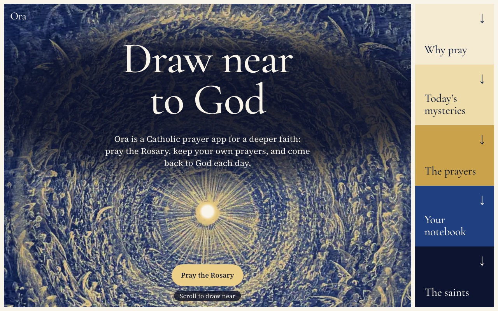

# Ora

**A calm Catholic prayer app for a deeper faith.** Pray the Rosary, keep your own prayers, and come back to God each day.

## What is Ora?

Ora is a prayer notebook you can carry in your pocket. It is built around two ideas:

- **The Rosary, guided and always available.** Pray it bead by bead, with no account and no connection needed.
- **Your own prayers, kept in one place.** Sign in and your prayers, collections, favorites and intentions are there whenever you return, on any device.

It is designed for one-handed use on a phone, often at night, in a quiet moment. It never nags, scores or pressures you to pray.

## What you can do

### Pray

- Pray the interactive **Rosary** for any set of mysteries, with today's mysteries suggested and the option to resume where you left off.
- Pray other devotions: the **Divine Mercy Chaplet**, the **Angelus**, the **Seven Sorrows** and the **Stations of the Cross**.
- See the **liturgical day**: season, week and celebration, with a link to the day's readings. The app's colors follow the liturgical season.

### Keep

- Build a **prayer library** with starter prayers plus your own, grouped into **collections**, marked as **favorites** and searchable.
- Write **intentions** and attach them to a Rosary, so you can see what you prayed for.
- Look back at your **Rosary history**, with gentle stats and a practice calendar.

### Share

- Send a prayer or collection as a **read-only link**. Stop sharing and the link stops working.

### Make it yours

- Scale the prayer text, choose a reading theme and keep the screen awake while you pray.
- Export your data or delete your account at any time.

## Principles

- **Calm over engagement.** No leaderboards, guilt-driven streaks or points.
- **Fidelity over cleverness.** Traditional prayers are presented exactly as the Church prays them.
- **Works anywhere.** The Rosary and your saved library keep working offline, and it installs like an app.
- **Yours first.** Your prayers and intentions are private by default.
- **Accessible.** Built to WCAG 2.2 AA, with scalable text and reduced-motion support.

## Who it's for

Individual Catholics who want a quiet, dependable place to pray and to keep what matters to them. Praying together as a family or parish is a possible future direction, not part of the app today.

## What's next

See [ROADMAP.md](ROADMAP.md) for what is done and what is under consideration.

## Built with

Next.js 16, React 19, TypeScript, Tailwind v4 and Supabase.
